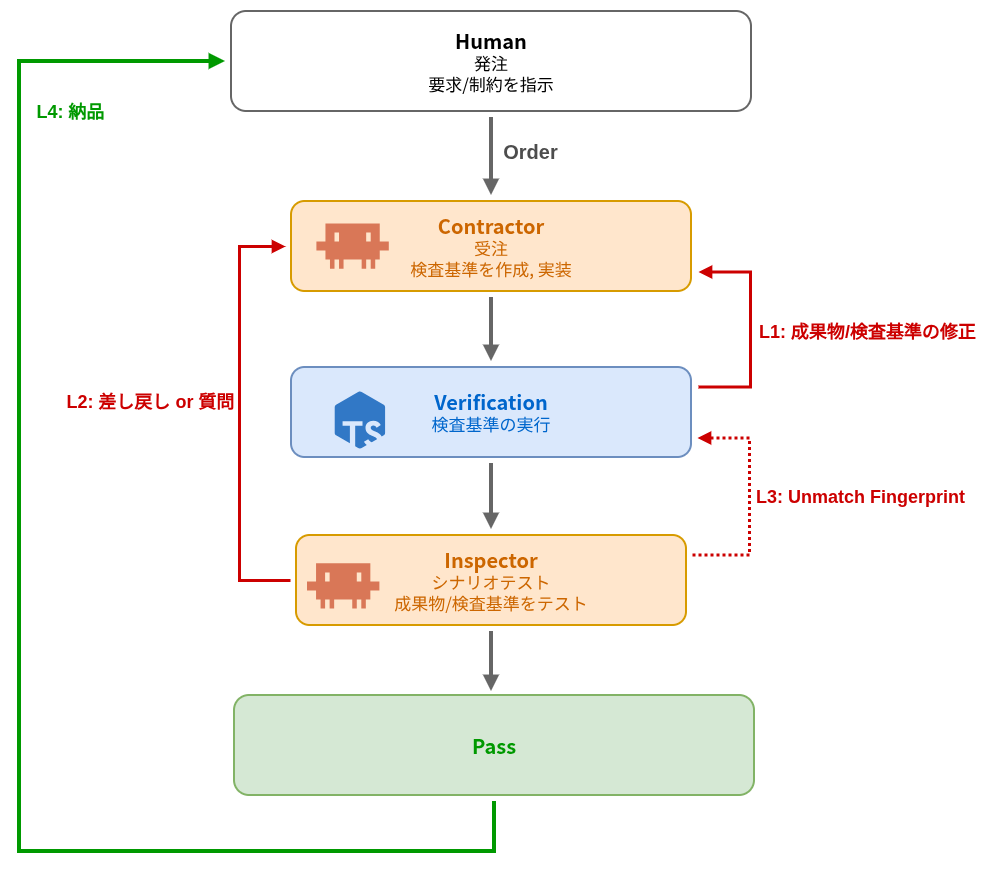

# **Kenshu-Loop(Acceptance Inspection Loop)** 


日本企業における 発注 -> 検収 -> 納品 の業務フローをモデルにしたエージェントループスキルです。

このスキルでは人間は要求を示すのみで、要件とゴール基準は明確に定めません。
曖昧な仕様でも高品質・短納期で仕上げなければならない、それが出来なければ「責任感が無い」と責められる悲しい日本企業の縮図をスキルにしました。

味わい深いJTCの風を感じられるスキルに仕立てました。


# アーキテクチャ

登場するエージェントは2つ, ContractorとInspectorです。

Contractorは設計・実装を行い、検査基準を作成します。
Inspectorは後述しますが様々な観点で成果物をチェックします。

- **人間はやりたいこと・利用状況・守るべき制約を自由に指示します**  
    指示をしたら実装・検証の過程で承認を要求しません。**お客様は神様であり、お手を煩わせてはならないためです**

- **納品は慎重に行います**  
    エージェントが自らに課した検査基準と動作確認をパスしなければ納品は出来ません

- **イチャモンつけられたら修正します**  
    Inspectorは2面性があり、責任を持ってテストをする側面と、責任の無いイチャモンをつける側面があります。
    責任を持ってテストをする場合、不具合や不良を発見しContractorに差し戻しを要求します。
    一方責任を持たないイチャモンをつける側面では、完璧に動作しても重箱の隅を突くような質問と疑問を投げかけます。
    Inspectorはこれらの2面をガードとして設けており、すべて通過しない限り成果物は納品出来ません。




## Installation
### vercel agent-skills
[vercel-labs/skills](https://github.com/vercel-labs/skills) の `skills` コマンドで導入します。

```sh
# プロジェクトに導入
npx skills add takeshiD/kenshu-loop

# ユーザー全体に導入
npx skills add takeshiD/kenshu-loop -g
```

### nix agent-skills
[agent-skills-nix](https://github.com/Kyure-A/agent-skills-nix) を使い、Home Manager で宣言的に導入します。

`flake.nix` の inputs に追加します。

```nix
inputs = {
  agent-skills.url = "github:Kyure-A/agent-skills-nix";
  kenshu-loop = {
    url = "github:takeshiD/kenshu-loop";
    flake = false;
  };
};
```

`outputs = inputs@{ ... }: ...;` で inputs を受け取り、Home Manager の `modules` に `inputs.agent-skills.homeManagerModules.default` を、`extraSpecialArgs` に `{ inherit inputs; }` を渡します。

Home Manager の設定に以下を追加します。

```nix
programs.agent-skills = {
  enable = true;

  sources.kenshu-loop = {
    input = "kenshu-loop";
    subdir = "skills";
  };

  skills.enable = [ "kenshu-loop" ];
  targets.claude.enable = true;
};
```

`home-manager switch` を実行すると `~/.claude/skills/kenshu-loop` に配置されます。

### 動作要件
- Node.js 22.18 以上と npm
- 認証済みの Claude Code CLI（`claude`）
- git

同梱 CLI は初回実行時に依存パッケージを `scripts/node_modules` へ導入します（ネットワーク接続が必要）。


## 設定（`.kenshu/config.json`）

少し設定出来ます。

| 項目                                                   | 既定              | 意味                                                                                                    |
| ---                                                    | ---               | ---                                                                                                     |
| `harness.bin` / `model`                                | `claude` / 未指定 | Claude Code 実行ファイル・モデル                                                                        |
| `harness.contractor.permission_mode`                   | `acceptEdits`     | 受注AI。対象ディレクトリを cwd に、`Read,Edit,Write,Glob,Grep,Bash` を許可（`WebFetch,WebSearch` 禁止） |
| `harness.inspector.permission_mode`                    | `dontAsk`         | 検収AI。`Read,Glob,Grep,Bash` を許可、`Edit,Write,NotebookEdit,WebFetch,WebSearch` 禁止                 |
| `*.max_budget_usd_per_call` / `timeout_minutes`        | 2・30 / 1・20     | 1回の呼び出し上限                                                                                       |
| `limits.max_rounds`                                    | 4                 | 納品回数の上限                                                                                          |
| `limits.max_minutes` / `max_budget_usd`                | 120 / 10          | 累積時間・累積コスト上限（resume をまたいで累積）                                                       |
| `limits.max_invalid_outputs`                           | 2                 | 不正な出力・ハーネス異常の連続許容回数                                                                  |
| `verification.command_timeout_ms` / `setup_timeout_ms` | 60000 / 300000    | 検証時のタイムアウト                                                                                    |
| `deploy_policy`                                        | `none`            | 外部への自動マージ・デプロイは行わない（初版は固定）                                                    |
# License
See [LICENSE](./LICENSE)
